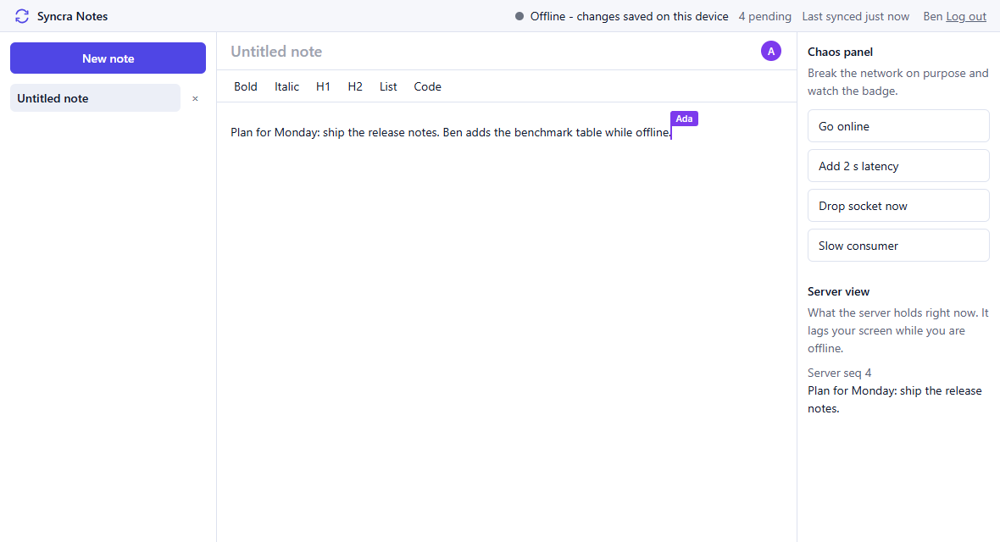
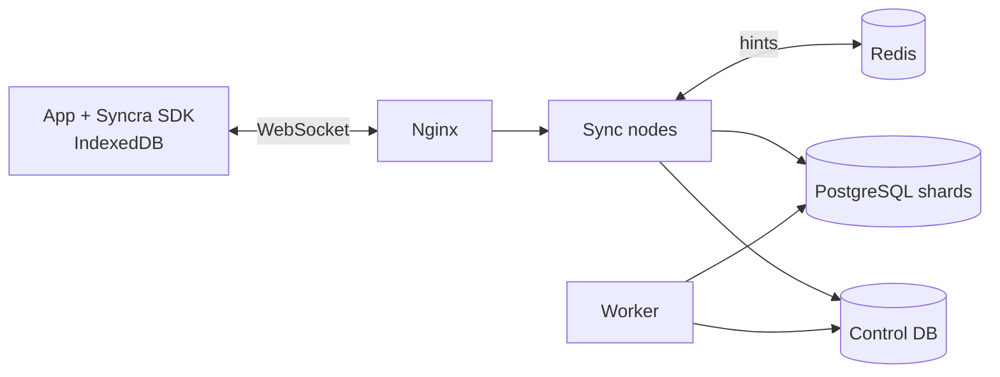
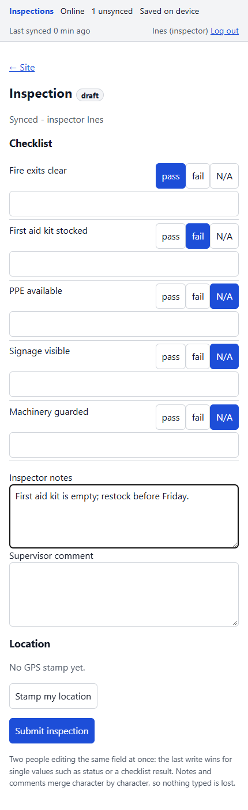
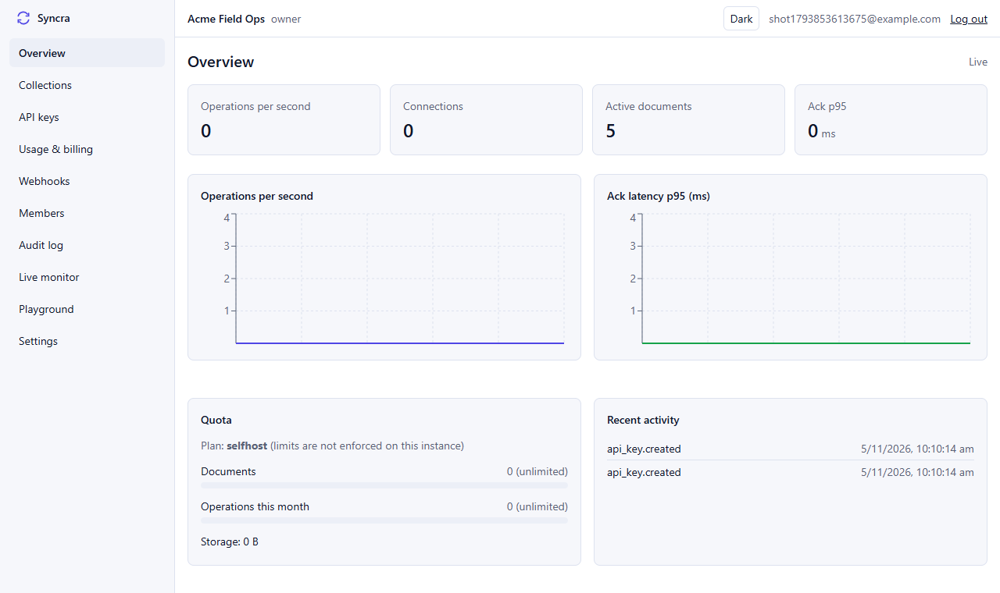

# Syncra

**Self-hostable sync for offline-first apps.** Your app keeps working with no network, and merges cleanly when it comes back.




> Status: early. No production users, no external security audit. Measured performance is from one laptop and one sync node (see [Benchmarks](#benchmarks)).

## Live demo

**https://syncra-silk.vercel.app/**: [notes demo](https://syncra-silk.vercel.app/notes/) (open it in two windows and go offline in one), [field inspection app](https://syncra-silk.vercel.app/inspection/), [dashboard](https://syncra-silk.vercel.app/dashboard/) and [docs](https://syncra-silk.vercel.app/docs/).

The sync server runs on a free host that sleeps when idle, so the first request can take up to a minute. The dashboard login is not published here; run the project locally (below) to get your own.

## Why Syncra?

- **Works offline.** Every edit is saved on the device first and sent when a connection is available.
- **Merges without conflict dialogs.** Text and lists merge automatically; the rules for single values are documented.
- **Self-hostable.** One Docker Compose file runs the server, worker, databases, dashboard and monitoring.

## Built on Yjs

Syncra does not invent a new CRDT. All merging is done by [Yjs](https://yjs.dev).

Syncra adds what a Yjs app still needs around it: a persistent multi-tenant sync server, access tokens, quotas, history and restore, a dashboard, and a client runtime with an offline outbox and multi-tab support.

## Quickstart

```bash
git clone https://github.com/munawwar-ali/syncra.git
cd syncra
docker compose -f infra/compose/docker-compose.yml up
```

The first start prints the dashboard URL, the demo notes and inspection apps, and the demo keys ([details](docs/getting-started.md)). The compose stack has been validated with `docker compose config` but its images have not been built or run by the author yet. Without Docker, `pnpm install && pnpm dev` starts a local single-node stack (embedded PostgreSQL) for development.

Add it to a React app:

```tsx
import { createClient } from '@syncra/client';
import { SyncraProvider, useDoc, useYMap, useSyncStatus } from '@syncra/react';

const client = createClient({
  url: 'http://localhost:8080',
  publishableKey: 'pk_live_...',
  getToken: () =>
    fetch('/api/syncra-token')
      .then((r) => r.json())
      .then((j) => j.token),
});

function Todo({ id }: { id: string }) {
  const { doc } = useDoc('todos', id);
  const todo = useYMap<{ title?: string; done?: boolean }>(doc);
  const { connection, pendingOps } = useSyncStatus();
  return (
    <label>
      <input
        type="checkbox"
        checked={todo.done ?? false}
        onChange={(e) => doc?.setFields({ done: e.target.checked })}
      />
      {todo.title} ({connection}, {pendingOps} unsynced)
    </label>
  );
}

export const App = () => (
  <SyncraProvider client={client}>
    <Todo id="first" />
  </SyncraProvider>
);
```

The packages are not published to npm yet; use the workspace packages in this repository. See the [full quickstart](docs/getting-started.md) and the [SDK guide](docs/sdk-guide.md).

## Features

- Offline-first client: IndexedDB storage, outbox, reconnect with backoff and jitter, multi-tab leader election
- Delta sync over WebSockets; HTTP pull/push endpoints exist for networks that block them (the SDK does not switch to them automatically yet)
- At-least-once delivery with idempotent operations
- Multi-tenant server: per-tenant token signing, API keys, roles, quotas, rate limits, audit log with hash chain
- History, time-travel view and non-destructive restore; snapshots and verified compaction
- Presence (cursors) across nodes; change feed (SSE) and signed webhooks
- Dashboard: live monitor, document inspector, keys, usage, webhooks, members, audit, playground
- Prometheus metrics, Grafana dashboard and alert rules
- REST API described in [OpenAPI](docs/openapi.yaml)

## Architecture



Clients keep a local copy of each document and send Yjs updates to a sync node. The node appends them to a PostgreSQL shard, acknowledges after the commit, and broadcasts to other subscribers. Redis only carries hints between nodes, so losing it delays fan-out but loses no data. A worker writes snapshots, verifies them, and compacts old operations.

More in [docs/architecture.md](docs/architecture.md), [protocol](docs/protocol.md), [sharding](docs/sharding.md) and [security](docs/security.md).

## Benchmarks

Measured on one laptop (Intel Core 5 210H, 16 GB, Windows) with one sync node, embedded PostgreSQL and the load generator on the same machine. Results come from the committed scripts in [`loadtest/`](loadtest); raw files are in [`loadtest/results/`](loadtest/results).

| Measurement                                            | Result                                                                           |
| ------------------------------------------------------ | -------------------------------------------------------------------------------- |
| 1,000 connected clients, 1 update per client every 5 s | 0 errors, 0 drops; ack latency p95 147 to 657 ms across 3 runs (p50 41 to 67 ms) |
| One document, 300 subscribers and 10 writers           | All 2,647 updates acknowledged                                                   |
| Reconnecting after 100 edits to a 102 KB document      | 3,884 bytes sent instead of 102,016 (about 26x less)                             |
| Compaction of a 20,000-operation document              | Cold load 2.8x to 3.5x faster; stored bytes 11% to 12% lower                     |

The project's latency target (ack p95 under 100 ms) is not met in these runs. Multi-node behaviour, 5,000 connections and node-failure recovery have not been measured. Details and caveats: [docs/benchmarks.md](docs/benchmarks.md).

## Demo apps

| App                                           | What it shows                                                                                                                    |
| --------------------------------------------- | -------------------------------------------------------------------------------------------------------------------------------- |
| **Notes** (`apps/demo-notes`)                 | Rich-text collaboration, live cursors, offline banner, a chaos panel (offline, 2 s latency, drop socket) and a server-view panel |
| **Field inspection** (`apps/demo-inspection`) | An installable PWA: 5,000 sites in a virtualized list, checklists, GPS stamp, inspector and supervisor roles, fully offline      |
| **Dashboard** (`apps/dashboard`)              | Live monitor, document inspector with a history slider, keys, usage, webhooks                                                    |




## Comparison

Choose Syncra if you want Yjs-style CRDT documents, self-hosting, and a ready platform. Choose another tool if you need relational sync, queries, or a fully managed service.

| Solution                                 | Strengths                                   | Trade-offs compared with Syncra's niche                            |
| ---------------------------------------- | ------------------------------------------- | ------------------------------------------------------------------ |
| Firebase Firestore                       | Mature, offline persistence, huge ecosystem | Hosted, vendor lock-in, field-level last-write-wins                |
| Hocuspocus, y-websocket, y-sweet         | Excellent Yjs servers                       | Less out of the box for tenancy, quotas, dashboard, client runtime |
| PowerSync, ElectricSQL, Replicache, Zero | Strong SQL-oriented sync                    | They sync relational data                                          |
| Liveblocks and similar                   | Polished collaboration platform             | Hosted and closed                                                  |

Full table: [docs/comparison.md](docs/comparison.md).

## Guarantees and limits

- **Delivery:** at-least-once with idempotent operations. A write is acknowledged after it is committed to PostgreSQL.
- **Consistency:** replicas that have received the same updates hold the same document. Concurrent writes to the same map key keep one value.
- **Not supported:** queries over document contents, end-to-end encryption, relational data, a managed hosted service.
- **Not verified yet:** the Docker deployment, multi-node load, and any third-party security review.

## Roadmap

Publish packages to npm, run and measure the multi-node stack, an admin CLI, request-id propagation into worker logs, Vue and Svelte bindings, a Terraform reference deployment. Contributions are welcome.

## Contributing and license

See [CONTRIBUTING.md](CONTRIBUTING.md), [SECURITY.md](SECURITY.md) and the [Code of Conduct](CODE_OF_CONDUCT.md). Licensed under [Apache-2.0](LICENSE).

Built with [Yjs](https://yjs.dev), lib0, Tiptap, Fastify, PostgreSQL, Redis, React, Vite and TanStack.
