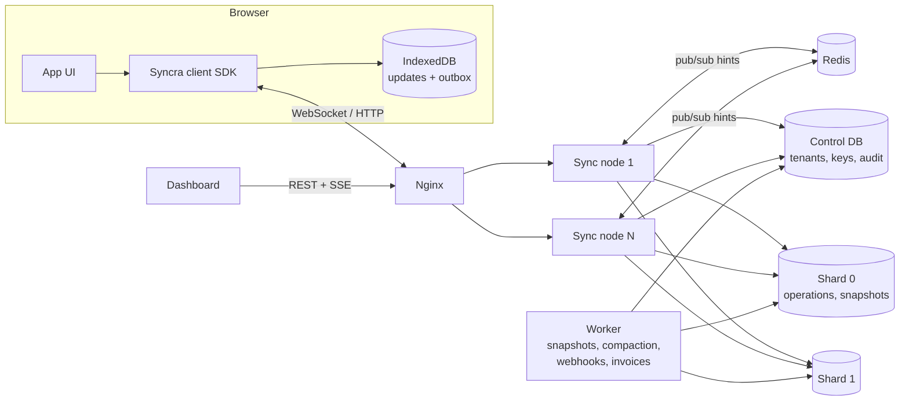
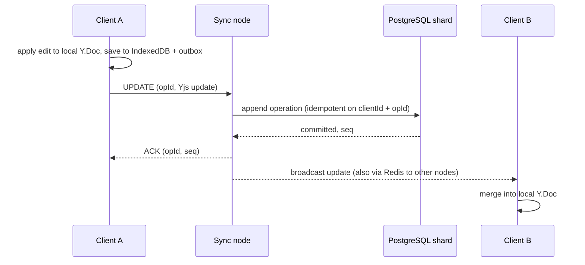

# Architecture overview

Syncra is built on [Yjs](https://yjs.dev). Clients keep a full local copy of each document and exchange Yjs updates with a sync server over WebSockets. PostgreSQL is the source of truth; Redis only carries hints between server nodes.

## Components

| Component  | Role                                                                                                 |
| ---------- | ---------------------------------------------------------------------------------------------------- |
| Client SDK | Local-first storage, outbox, reconnect state machine, multi-tab leader election                      |
| Sync node  | WebSocket gateway, auth, rate limits, per-document write batching, REST API                          |
| Worker     | Snapshots, compaction, checkpoints, webhook delivery, usage rollups, invoices                        |
| Control DB | Tenants, users, API keys, webhooks, usage, audit log                                                 |
| Shards     | Append-only operations and snapshots, assigned by a consistent-hash ring ([sharding](./sharding.md)) |
| Redis      | Cross-node fan-out hints, presence, shared rate-limit buckets. Not a source of truth                 |

## Life of an edit

An edit is acknowledged only after it is committed. If an acknowledgement is lost, the client resends; the server recognizes the operation and acknowledges it again. Delivery is at-least-once, and operations are idempotent.

## Reconnecting and catching up

On connect, the client sends its state vector and receives only what it lacks (delta sync). If a server node misses a broadcast, it notices a gap in the sequence numbers and reads the missing operations from PostgreSQL. A periodic check does the same when Redis was unavailable. Because the database is the truth, losing Redis delays fan-out but loses no data.

## Storage lifecycle

Each document is an append-only log of operations. The worker writes snapshots, verifies that replaying the snapshot yields the same document, and only then deletes the operations it covers. Checkpoints taken over time power the history view and restore.

## Multi-tenancy

Documents and operations are stored with their tenant id, and every lookup is scoped to the caller's tenant. Client tokens are signed with a per-tenant secret, and token access rules limit collections, documents and read/write mode. See [security](./security.md).

## What Syncra is not

It is not a database: there are no queries over document contents. It does not provide end-to-end encryption. Relational sync is out of scope; see the [comparison](./comparison.md).
